  

---

  

---

## 🛠 Tech Stack

**Languages**

**Frameworks & Runtimes**

**Data & ML**

**Tooling**

---

## 🚀 Projects

<table width="100%">
<tr>
<td width="50%" valign="top">

### ⚡ [Flux](https://github.com/owaisraza40/flux)

Open-source Windows download manager built from scratch — native dark UI, adaptive parallel transfers (up to 32 connections), durable pause/resume, queue management, scheduling, and full browser integration via Chrome/Edge/Firefox extensions. Packaged as an NSIS installer, portable ZIP, and browser extensions with automated SHA-256 verification.

[📥 Download v1.0.0](https://github.com/owaisraza40/flux/releases/tag/v1.0.0) · [📖 Docs](https://github.com/owaisraza40/flux/blob/main/docs/USER-GUIDE.md)

</td>
<td width="50%" valign="top">

### ✈️ [AeroNexus](https://github.com/owaisraza40/AeroNexus-backend)

Full-stack aviation management system with a high-performance C++ REST API backend — token-based auth, role-based access control, CSV persistence, searchable flight records, and status-flow enforcement. React frontend, fully Dockerized and deployed.

[🌐 Live Demo](https://aero-nexus-backend.vercel.app)

</td>
</tr>
<tr>
<td width="50%" valign="top">

### 🧠 [Sentiment Analysis](https://github.com/owaisraza40/Review-Analysis-Sentiment-Analysis)

NLP pipeline for product review sentiment classification — text preprocessing, feature extraction, model training, and evaluation. University NLP project applying real-world ML techniques to unstructured data.

</td>
<td width="50%" valign="top">

### 🌐 [Portfolio](https://owaisraza40.github.io)

Personal portfolio deployed on GitHub Pages — built from scratch with HTML, CSS, and vanilla JS. Iteratively designed, currently in a sage/cream editorial direction.

[🌐 Live](https://owaisraza40.github.io)

</td>
</tr>
<tr>
<td width="50%" valign="top">

### 🧮 [Streamlit Calculator](https://github.com/owaisraza40/streamlit-basic-calculator)

Web-based calculator built with Python and Streamlit — quick exploration of Streamlit's interactive app model with clean UI and instant deployment.

</td>
<td width="50%" valign="top">

### 💻 [PROJECT-PF](https://github.com/owaisraza40/PROJECT-PF)

C++ programming fundamentals project — structured data management, OOP principles, and clean modular design. Foundation of the C++ background carried into every project since.

</td>
</tr>
</table>

---

## 📊 Stats

&nbsp;

---

## 🐍 Contribution Graph

<picture>
  <source media="(prefers-color-scheme: dark)"
    srcset="https://raw.githubusercontent.com/owaisraza40/owaisraza40/output/github-contribution-grid-snake-dark.svg"/>
  <source media="(prefers-color-scheme: light)"
    srcset="https://raw.githubusercontent.com/owaisraza40/owaisraza40/output/github-contribution-grid-snake.svg"/>
  
</picture>

---

  <a href="https://www.linkedin.com/in/owais-raza-13034539a/">LinkedIn</a> ·
  <a href="mailto:owaisraxa40@gmail.com">Email</a> ·
  <a href="https://owaisraza40.github.io">Portfolio</a>

